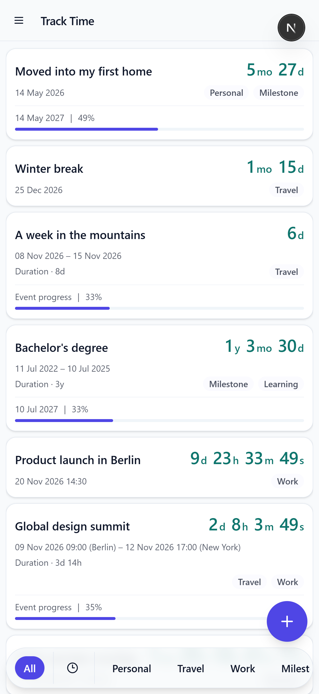
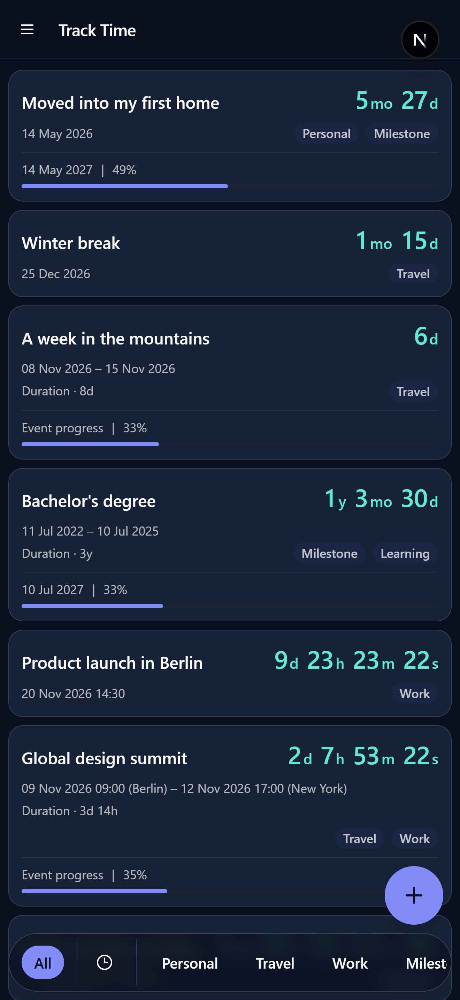
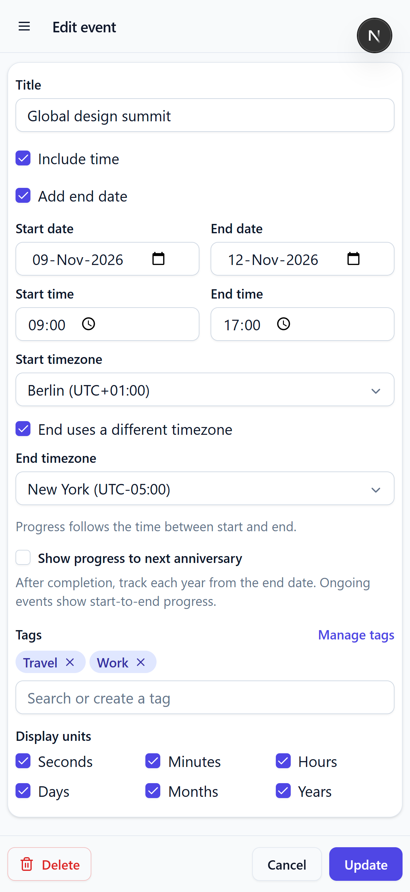

# Track Time

**Keep the moments that matter in view.**

Track Time is a personal time-tracking app for dates you care about. Create an event to see a live countdown, how long ago something happened, or your progress through a date range. It is a hobby project built to explore thoughtful date handling, offline web apps, and keeping personal data in the browser.

## Screenshots

| Event list · light mode                                                               | Event list · dark mode                                                                    |
| ------------------------------------------------------------------------------------- | ----------------------------------------------------------------------------------------- |
|  |  |

**Time zone event · light mode**



## What it can do

- Track a date as a countdown before it happens and elapsed time afterward.
- Add a start and end date to follow an event through its full duration.
- Use precise times and IANA time zones, including different zones for each endpoint.
- See progress through an active date range or toward the next annual anniversary.
- Organize events with tags and choose which time units appear in counters.
- Load and remove a sample set from **Backup & restore** for a quick walkthrough, without affecting personal events.
- Keep events and tags in browser storage, use the app offline after the first online visit, and export or restore an encrypted backup.

## A few details I cared about

Date-only events and timed events behave differently, so the app stores date-only values as calendar dates and timed values as UTC timestamps with their selected time zone. Date-only ranges include both dates; for example, August 10–16 lasts seven calendar days and ends at the start of August 17 in the viewer's local time.

Annual progress follows the event's selected endpoint and resets each anniversary. February 29 anniversaries fall on February 28 in non-leap years. For timed events, the anniversary uses the saved endpoint time zone.

The app uses a service worker to cache the shell and route assets for later offline visits. Event data stays in IndexedDB on the device. Backups can be downloaded as encrypted JSON and restored on another browser or device with the backup password.

## Run locally

You'll need Node.js and npm installed.

```bash
npm install
npm run dev
```

Open [http://localhost:3000](http://localhost:3000) in your browser. To create a production build, run:

```bash
npm run build
npm run start
```

## Built with

Next.js, React, TypeScript, Tailwind CSS, and Dexie for IndexedDB. The app is installable as a progressive web app and uses Serwist for service-worker support.

## For reviewers

This project includes focused tests for date calculations, event progress, backup and restore, offline navigation, and key UI interactions. Run them with:

```bash
npm test
```
